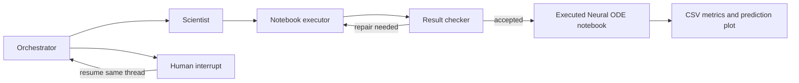
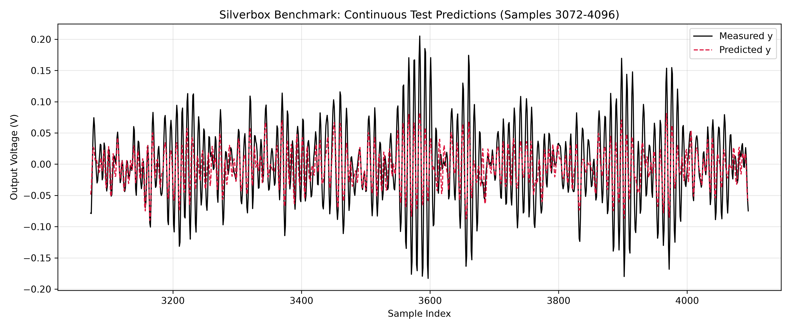

# Multi-Agent Neural ODE

This repository contains a LangGraph workflow that asks several specialized agents to design, generate, execute, check, and repair a compact Neural ODE experiment for the Silverbox benchmark.



## Repository contents

| Path | Purpose |
| --- | --- |
| `agent/task6.ipynb` | Multi-agent LangGraph workflow and prompts |
| `generated/Duffing_generated.ipynb` | Notebook produced by the agents and executed successfully |
| `results/comparison.csv` | Machine-readable baseline settings and metrics |
| `results/test_prediction.png` | Measured and predicted test signals |
| `run_evidence/` | Execution summary and captured standard output/error |
| `human_in_loop_runs/` | Committed checkpoint transcripts and destinations for later demonstration runs |
| `tests/test_hitl_contract.py` | Offline interrupt, refusal, resume, and code-cell checks |

## Human-in-the-loop extension

Both agent variants now support a fifth `human` destination. The orchestrator's model call selects it when a request is meaningfully ambiguous or when the next action would execute code, overwrite a result, or report a measurement.

The graph is compiled with an in-memory checkpointer. A human question pauses the current thread through `interrupt()`, and `Command(resume=...)` continues that same thread. The reply is appended to the shared dialogue with role `human`. Refusing a hard action returns control to the orchestrator without running the executor.

The notebook includes two checkpointed demonstrations for the notebook-generating graph, followed by equivalent validation cells for the Python-file graph. The demonstrations now pause in the running cell at `YOUR REPLY:`, accept a manually typed answer, and resume the same thread automatically.

## Recorded human decisions

Two real notebook-graph checkpoint snapshots are committed as report evidence:

- [`ambiguous_run.json`](human_in_loop_runs/notebook_graph/ambiguous_run.json) records the ambiguous failure-diagnosis request, the human clarification that forbids repair or execution, and the general agent's explanation. Its `executor_runs` value is `0`.
- [`hard_run_after_refusal.json`](human_in_loop_runs/notebook_graph/hard_run_after_refusal.json) records the scientist's larger-model comparison strategy, the first executor approval question, the human refusal, and the second approval interrupt. Its `executor_runs` value is also `0`, proving the refused action did not run.

These files are checkpoint snapshots rather than invented example conversations. The accepted hard-action transcript and combined screen-recording transcript are created only after the corresponding interactive cells complete successfully.

## Successful baseline

The generated notebook uses the 4096-sample Silverbox excerpt `42650:46746`, with 3072 training samples and 1024 test samples. The model learns acceleration as

\[
y' = v, \qquad v' = \alpha_\theta(y,v,u)
\]

and performs a continuous rollout without resetting the state at the train/test boundary.

| Setting | Value |
| --- | --- |
| Network | `3 -> 64 -> 64 -> 1` |
| Activation | Tanh |
| Optimizer | Adam |
| Learning rate | `1e-3` |
| Rollout length | 32 |
| Updates | 800 |
| Training time | 48.69 s |
| Train RMSE | 0.034713 V |
| Test RMSE | 0.039680 V |
| Zero-prediction test RMSE | 0.060492 V |



## Run locally

The notebooks expect the Silverbox file `SNLS80mV.mat`. The dataset is not included in this repository. Update `DATA_PATH` in the notebook copies to the location of the file on your computer.

In PowerShell:

```powershell
python -m venv .venv
Set-ExecutionPolicy -Scope Process -ExecutionPolicy Bypass
.\.venv\Scripts\Activate.ps1
pip install -r requirements.txt
$env:GOOGLE_API_KEY = "your-key-here"
jupyter lab agent/task6.ipynb
```

The API key is read from the environment and is not stored in the repository. Run `generated/Duffing_generated.ipynb` directly if you only want to reproduce the numerical experiment and already have the data file.

## Scope

This run intentionally validates one baseline configuration first. The repository records the resulting end-to-end pipeline and its actual outputs; it does not claim a full architecture search or a final optimized physical model.
